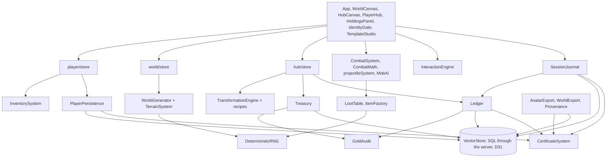

# World Seed: Design Handover

For the next builder, human or agent. It describes the game as it is today, including what does not work. The vision is in `agent.md` and the build order in `PLAN.md`.

**State on 2026-10-30:** the full loop is playable in a browser on one machine. It is not yet multiplayer, has no server, and has never been played by a person from start to finish.

**Reconciled with the code on 2026-10-31, at commit d75f541 (through Wave 10E).** Section 1 is still the Wave 7 run and has not been repeated; Wave 12 repeats it. Pedro has played parts of the game since, and that play produced the fixes listed in `BUILDERS_LOG.md`. Sections 2 to 9 were checked against the code and corrected. For the record of each wave after 7, read `PLAN.md` section 3B.

Run it:

```bash
npm install
```
```bash
npm run dev
```
```bash
npm test
```

The game runs on `http://localhost:3000`. The USER/DEV toggle in the bar turns on the admin tools and the "grant deed" button in Holdings.

---

## 1. True test results

Lines are from `PLAN.md` section 0. The final run used a fresh profile and real clicks and key events through the game's own handlers. Page scripts only read state, apart from wiping the browser and supplying backup files.

| # | Line | Result | Evidence and limits |
|---|---|---|---|
| 1 | Create identity | Pass | Real form |
| 2 | Reload, identity persists | Pass | Signature verified on load |
| 3 | Enter hub, state restored | Pass | 500G and name shown |
| 4 | Buy a tool | Pass | Real shop; gold moved, item in stash |
| 5 | Deploy, scan, drop | Pass | World created through the real form; landed in the chosen sector |
| 6 | Terrain matters | Pass | Rendered live; blocking and mud covered by tests |
| 7 | Harvest, wrong tool refused | Pass | Axe and bare hands live; refusal covered by tests |
| 8 | Mine, vein depletes | Pass | Pick on rock: uses 2, 1, then gone |
| 9 | Ruin, garrison, chest, lore | Pass | Two guards defeated with an equipped bow |
| 10 | NPC recruited | Pass, with a gap | Real menu to 70, bond received. **The bond was never carried to an exit** |
| 11 | Pack fills, forced choice | Pass | Happened naturally: 37.6/40kg, slowed, overflow cache, items left behind and recovered |
| 12 | Exit point, channel, fee | Pass | Channel completed; interruption by damage seen; fee charged |
| 13 | Haul banked and signed | Pass | Item provenance verified |
| 14 | Reload, all still there | Pass | Ledger chain and gold audit clean |
| 15 | Deed, lot, workshop | **Assisted** | Redeem and build are real; the deed came from the dev button. Natural drops are only covered by a test |
| 16 | Refine at a workshop | Pass, with a change | Sand to glass, not log to planks. Same code path |
| 17 | Another identity buys | Pass, with a limit | Real second identity, **same browser and database** |
| 18 | Penalty from world rules | Pass | Happened repeatedly: carried items lost, receipt sealed as `DIED` |
| 19 | Export, wipe, restore | Pass, with a limit | Byte-identical after a total wipe. **Same browser profile**, and hub state does not travel (see debt) |
| 20 | Same seed, same map | **Partial** | Node and browser produce the same pinned hashes; a stored world matched a fresh generation. **Not run on two separate clients** |

**What this does not prove:**

- It was not one unbroken sitting. It took several sessions, and code was fixed between them.
- There has been no clean re-run on the final code. Automated tests cover the fixes, and the later sessions ran on most of them.
- A script drove the game, so nobody has judged how it feels. A human playtest is the real next step.
- The production build compiles (re-checked 2026-10-31) but has never been run.

---

## 2. Systems map



| System | File | Responsibility |
|---|---|---|
| Identity | `entities/identity/certificateSystem.ts` | Keypair, sign, verify |
| Saves | `logic/persistence/PlayerPersistence.ts` | Signed bank doc; verified on load |
| Session record | `logic/journal/SessionJournal.ts` | Signed claim and receipt per session |
| Ledger | `logic/ledger/Ledger.ts` | Append-only signed rows, one chain per identity |
| Gold | `logic/economy/Treasury.ts`, `ExitLevy.ts`, `GoldAudit.ts` | Treasuries, exit fee, ledger replay |
| Backup | `logic/sovereignty/AvatarExport.ts` | Sealed avatar file |
| Item history | `logic/sovereignty/Provenance.ts` | Signed events per banked item |
| World files | `logic/sovereignty/WorldExport.ts` | World certificate transport. No UI yet |
| Generation | `entities/world/WorldGenerator.ts`, `TerrainSystem.ts`, `goldens.ts` | Seed to map; pinned hashes |
| Combat | `entities/combat/*`, `entities/mob/ai/MobAI.ts` | Projectiles, hits, enemy behavior |
| Pack | `entities/player/systems/InventorySystem.ts` | Grid and weight, pure functions |
| Economy | `entities/hub/store.ts`, `entities/economy/*` | Lots, building, crafting, shops, upkeep |

Added since Wave 7, and not all drawn on the diagram above:

| System | File | Responsibility |
|---|---|---|
| Atoms | `render/atoms/*`, `render/FieldRenderer.ts` | Everything drawn: terrain, creatures, items, people, rooms, the survey |
| Screen kit | `components/ui/*` | One theme and the shared controls; colors come from the atoms' ramps |
| Rooms | `entities/hub/room.ts`, `render/atoms/room.ts` | Build records, walkability, refusals, bills by tag |
| Templates | `entities/hub/template.ts`, `logic/systems/TemplateSystem.ts`, `components/TemplateStudio.tsx`, `components/TemplateApplyModal.tsx` | Signed plans, kept apart from materials |
| Load-out | `entities/player/systems/LoadoutSystem.ts`, `components/PaperDoll.tsx` | The slot tree, requirements, the head budget |
| Carts | `entities/world/CartSystem.ts`, `entities/world/CartOverlay.ts` | Towed world entities; the one thing in a world not derived from its seed |
| Item anatomy | `logic/economy/CompositionSystem.ts`, `logic/economy/MintRegistry.ts`, `logic/systems/ImprovisedCrafting.ts` | What an item is made of, its price and power, global uniqueness |
| Content banks | `logic/content/AffixBank.ts`, `entities/world/Dreaming.ts`, `entities/generation/packs/affixBatches.ts` | Versioned affix packs; a world pins its version at mint |
| Knowledge | `logic/systems/StudySystem.ts` | Identify as a trained skill scoped by item type; goods and furniture joined the scopes in the raw materials leg |
| Processes | `logic/systems/ProcessSystem.ts` | What a transformation step adds; pools by rank and rarity; the reveal by skill and lore |
| The tag law | `logic/content/TagLaw.ts`, `logic/content/WebBank.ts` | One registry, canonical identity, the web's batch law, derived connections (D27–D29) |
| The web | `logic/systems/WebSystem.ts` | The mint, the auto skill and the rest, rungs and their reveal, nodes, verbs, stations, reverse engineering, the hub's web, migration |
| NPC sheets | `logic/systems/NpcSheet.ts` | Stats and skills dealt at read time from (world seed, entity, pinned web); read back from a bond |
| Sourcing audit | `logic/economy/SourcingAudit.ts` | Line 45 over the live definitions |
| Protection | `logic/systems/InsuranceSystem.ts` | Charms and scrolls that name what a death keeps |
| Entry | `logic/systems/Deploy.ts`, `entities/identity/roster.ts` | One door into a world; several avatars per device |
| Controls | `logic/systems/FieldInput.ts`, `components/Hotbar.tsx` | Hold to fire, the one interact key, the hotbar |
| Character sheet | `components/CharacterSheet.tsx` | One key, field and city: attributes, skills, the body, the pack or the vault |
| The hands | `logic/systems/ItemHands.ts`, `components/ui/hands.tsx`, `components/ui/ItemGrid.tsx`, `entities/player/systems/StashGrid.ts` | Any item from any place to any other, through the store's doors; the vault's grid |
| The card on hover | `components/ui/HoverLayer.tsx`, `render/atoms/inspect.ts` | One layer, placed clear of its thing, compared through the blind sheet |
| Minimap | `render/atoms/minimap.ts`, `components/ui/MinimapView.tsx` | Field and city, from the atoms; the field keeps the fog |

Paths are under `src/`. Note that `WorldCanvas.tsx` still contains the game loop. It should move out of the component.

---

## 3. The contract (`types.ts`)

Treat `types.ts` as the shared agreement, and only add to it. These additions were made during the build:

| Addition | Meaning |
|---|---|
| `ItemType.LORE` | Lore fragments and escort bonds |
| `IGridPlacement`, `inventoryLayout` | Where each item sits in the pack |
| `IEquippedSlots`, `equipped` | Wave 4's buckets. Superseded by `IEquipmentState` in Wave 10C and kept so `LoadoutSystem.migrate` can bring old saves in |
| `kitItemIds` | What came in with the player. The exit fee ignores these |
| `carryItemIds` | Stash items chosen for the next session; tools always go |
| `IEquipmentState`, `BODY_SLOT_IDS`, `TOOL_SLOT_COUNT`, `HEAD_BUDGET_POSITIONS`, `MAX_FRAMES` | The body. Equipped items leave the pack and live on `IPlayer.equipment` (Wave 10C) |
| `MENTAL_ATTRIBUTES`, `PHYSICAL_ATTRIBUTES` | The D22 partition: mental stats come only from frames |
| `ISlotProtection` | A slot a named magic keeps through a death (D21) |
| `IComposition` | What an item is made of, its chain and its depth (Wave 10D) |
| `IBankedAffix`, `IAffixBatch`, `IContentPack` | The content banks (Wave 10E) |
| `ROOM_ACTING_STATS`, `IItem.loreData` | The stats an addition acts through in a room; a trade note's reading (raw materials leg) |
| `TagKind`, `TAG_KIND_IDENTITY`, `ITagEntry`, `IWebBatch`, `IWebPack`, `IHubWeb`, `ISkillProgress` | The tag law and the web's content (D27, D28) |
| `IItem.bondData`, `IPlayer.skillProgress`, `ISkillState.rank`/`legacy`, `IMaterialKnowledge.graded`, `IWorldRules.webVersion` | A bond's person; work toward a skill; rank beside identity; the graded rung; the web's pin |

Two contracts live outside `types.ts`: `IWorldRules` (with `contentPackVersion`) in `entities/world/WorldCertificate.ts`, and the room and template types in `entities/hub/room.ts` and `template.ts`.

Do not change `universalDefinitionId` or the meaning of `UniversalRank`. Saved items and generation depend on both.

---

## 4. Data model

Everything lives in a SQL database reached through a small server (D31): a SQLite file at `data/test-claude.db` (Pedro plays on `data/test-pedro.db`, sharing the base through `server/syncBase.ts`), one per checkout and never committed, or Postgres at deploy. The private key stays in the browser's IndexedDB (`WorldSeedIdentity`) and the certificate in `localStorage`; neither reaches the server. A wiped browser restores from the avatar backup, then finds its saves in the database. The old RxDB collection (`worldseed_db`) is read once by the import and otherwise left alone.

The namespaces below are the `VectorStore` interface. An id decides the table underneath: `ledger_{uid}_{seq}` goes to `ledger_rows`, `treasury_{world}` to `treasuries`, the head is derived from `MAX(seq)`, and everything else goes to `documents`, with its data as byte-identical text and columns for type, genre and owner beside it. `commits` records every commit that landed, so a retry applies once.

| Namespace | Document id | Contents |
|---|---|---|
| `characters` | identity uid | Signed bank doc, session removed |
| `transactions` | `ledger_{uid}_{seq}`, `ledger_head_{uid}` | Signed ledger rows and the head pointer |
| `transactions` | `session_{id}` | Signed session receipt |
| `items` | `prov_{itemId}` | Signed provenance chain |
| `worlds` | `inst_{seed}_{size}` | Generated map instance |
| `items` | `mint_registry_v1` | Every rolled item's claimed tuple (D18) |
| `content` | definition id | Item, enemy, resource and other definitions; world certificates |
| `content` | `content_pack_v{n}` | The signed content pack |
| `territories` | `hub_state_{uid}` | Lots and crafting jobs |
| `territories` | `treasury_{uid}`, `endowment_{uid}` | Treasury balance and its one-time starting fund |
| `territories` | `world_carts_{worldUid}` | The carts standing in a world |
| `territories` | `home_hub_{uid}` | Which hub is this avatar's own (D31) |
| `territories` | `browser_import_{origin}`, `import_refused_{uid}` | The one-time import's receipt, and an avatar it refused |

The avatar roster sits in `localStorage` too (`worldseed_avatars`), beside the active certificate.

**Ledger row types:** `CHARACTER_GENESIS`, `SESSION_RESULT`, `GOLD_DELTA`, `TAX`, `TRADE`, `CRAFT`, `BUILD`, `DESIGN`, `UPKEEP`, `TOMBSTONE`. Rows are never deleted, and appends are queued because each one reads the head first.

**Gold rule:** every movement has a ledger row, and goes through `GoldCommit`: the bank doc, the treasury, the rows and any hub state in one SQL transaction. `GoldAudit` checks that a player's gold equals their rows, and that treasuries equal the endowments plus all rows in the database, now across every hub in it.

---

## 5. Signing model

| What | Signed by | Checked when |
|---|---|---|
| Bank doc | Player key | Every load; failure refuses the save |
| Ledger rows | Player key | `Ledger.audit`, avatar import |
| Session receipt | Player key | Not checked anywhere yet |
| Item provenance | Acting player's key | `Provenance.verify` |
| World certificate | Creator key | **Never verified** |
| Construction and placement steps | Owner's key, as `BUILD` rows | `Ledger.audit` |
| Templates | Author's key; the author rides every copy | Through item provenance |
| Content pack | The loading identity's key, at hub load | **Signature never verified by code.** The bank law refuses a broken batch whole before it is signed |
| Cart theft | The taker's own certificate, in the cart's log | Read on the card |

**Since D31:** signed documents rest as byte-identical text, so a signature means the same after the database as before. The server checks no signatures: it holds no keys and is no notary. The one-time import does check them, in the browser, and a restore refuses a backup whose chain disagrees with the database. World certificates and content packs cannot be verified as stored, whoever tries: `signPayload` signs over a timestamp, and they keep only the signature.

**What this protects against:** accidental corruption and casual edits to stored data. A changed save or backup file is refused.

**What it does not protect against:** the player. The private key is extractable and sits in the same browser, so anyone willing to open the console can re-sign anything they like. Nothing here is anti-cheat. Stopping that needs a server that replays session records from the seed, which the journal and keyed rolls were designed to allow but which does not exist.

A provenance record carries its signer's public key. That proves the chain is intact, not whose key it is. Linking keys to identities needs a registry.

---

## 6. Determinism charter

- Every gameplay roll comes from `Rng.fromKey(key)`. The same key always gives the same result.
- Key formats: loot `{seed}:{sessionId}:loot:{mobId}`, harvest `{seed}:{sessionId}:harvest:{nodeId}:{use}`, shop `{hubId}:shop:{day}:{type}:{rank}:{slot}`, terrain `{seed}:elev:v1:{x},{y}`.
- `Math.random` in gameplay is a bug. `WorldCertificate.ts:316` is allowed because it creates a new world's identity. `SpellEngine.ts:23` still uses it, but nothing imports that module, so it does not run today; fix it before wiring spells in. The unkeyed fallbacks in `ItemFactory`, `LootTable` and `TransformationEngine` log a warning.
- `crypto.randomUUID` remains for identifiers, never for rolls: session ids (`player/store.ts:948`), world drops (`WorldCanvas.tsx:1102`, `:1121`), and log rows. `history.dropDate` stamps wall-clock time on mints.
- A world's contents derive from (seed, pinned pack version), so added content never changes an existing world. The hub's shelf deliberately rolls from the latest bank.
- Definitions are sorted by id before generation, so database order cannot change a world.
- `tests/world.test.ts` and the boot check pin three reference hashes. If you change generation on purpose, recapture them with `window.__captureGoldens()` in dev and paste the output into `goldens.ts`. Bump the layer version (for example `elev:v1`) when old worlds must keep their shape.
- Stored world instances are not regenerated, so a generation change does not reach a world that is already stored.

---

## 7. Tuning table

These are the current values, set by reasoning and very little play. Expect to change them.

| Value | Current | Where |
|---|---|---|
| Walking pace | `BASE_WALK_TILES_PER_S` 4 tiles/s (80px/s), × (1 + `movement_speed` on worn gear), then load, tow and ground. Field and city alike, no ceiling | `LoadoutSystem.ts` |
| Enemy speed | The definition's own `speed`, default 2 tiles/s | `MobAI.ts` |
| Enemy alert range | The definition's `viewRange`, default 8, capped at 16 tiles | `MobAI.ts` |
| Enemy give-up range | The larger of 16 tiles and twice the alert range | `MobAI.ts` |
| Enemy attack interval | 2s | `MobAI.ts` |
| Projectile speed / flight | 200px/s for 2s | `projectileSystem.ts` |
| Hit radius, enemy / player | 20px / 15px | `CombatSystems.ts`, `WorldCanvas.tsx` |
| Weapon damage | 6 + item power × 0.08 | `CombatMath.ts` |
| Unarmed damage / rate | 5 / 1 per second | `CombatMath.ts` |
| Mitigation cap | 60% | `CombatMath.ts` |
| Starting health | 100 + constitution × 10 | `player/store.ts` |
| Pack | 8 × 6 cells | `InventorySystem.ts` |
| Carry limit | 30 + strength × 10 kg, plus bags; equipped gear does not count | `InventorySystem.ts` |
| Tool slots / frames at most | 1 / 3 | `types.ts` |
| Cart bed | 10 × 8 cells | `CartSystem.ts` |
| Over-load slowdown | Above 80%: 0.5× speed | `InventorySystem.ts` |
| Channel / exit range | 5s / 60px | `WorldCanvas.tsx` |
| Interact reach | 4 tiles, nearest first | `logic/systems/FieldInput.ts` |
| Exit fee | World rule, default 5% of what was gained | `ExitLevy.ts` |
| Spawns per quadrant | Enemy pack 45%, ruin 10%, NPC 6%; resources by biome | `WorldGenerator.ts` |
| Material dream on a harvest | 8% | `Dreaming.ts` |
| Process pools | Tier 1 + rank step + rarity step, 4 at most | `ProcessSystem.ts` |
| Trade XP per finished job / to reveal a tier | 20 / level = tier + 1 | `ProcessSystem.ts` |
| Trade note in a chest fragment | 25%, worlds pinned at v4 or later | `ProcessSystem.ts` |
| Winging it, harvest energy / bench clock | ×1.5 / ×1.25 | `WebSystem.ts` |
| Each rung, energy / clock | −10% / −5% | `WebSystem.ts` |
| Mastery rungs, cumulative XP | 0, 60, 180, 420 | `WebSystem.ts` |
| Emergence DC / chance once past it | 10 + 10 per rank / 20 + how far past, 95 at most | `WebSystem.ts` |
| NPC skills / stat deal | 1 + rank index / 1 + rank + a shuffled nature | `NpcSheet.ts` |
| Room bonus caps | Upkeep 40%, bench speed 30%, no floor | `hub/room.ts` |
| Field identify | 12s, falling with skill, never under 2s | `StudySystem.ts` |
| Attribute points per rank-up | 3 | `ProgressionSystem.ts` |
| NPC secure threshold | 70 disposition | `InteractionEngine.ts` |
| Starting gold | 500 | `player/store.ts` |
| Shop markup / vendor buyback | 1.5×, consumables 3× / 0.6× of value | `hub/store.ts` |
| Player shop fee | 5% | `recipeDefinitions.ts` |
| Lot price | 5,000G (a fresh origin holds 500) | `hub/store.ts` |
| Shell bills | House 4 building; Workshop 6 building + 2 metal, the first one 6 building alone; Vendor 6 building + 1 glass | `hub/room.ts` |
| Build cost | House 100, Workshop 150, Vendor 250 | `recipeDefinitions.ts` |
| Upkeep per day | Empty 5, House 5, Workshop 10, Vendor 15 | `recipeDefinitions.ts`, `hub/store.ts` |
| Hub starting fund | 100,000G | `hub/store.ts` |
| Shell build time | House 30s, Workshop 45s, Vendor 60s | `hub/room.ts` |
| Autosave delay | 10s, plus immediately on hub actions | `PlayerPersistence.ts` |
| A waiting request's retry | 400ms, doubling to 4s | `StoreClient.ts` |
| The gate's knock while closed | 2s | `VaultGate.tsx` |
| SQLite writer's wait for its turn | 30s | `server/connection.ts` |
| Standalone server's default port | 3900 | `server/main.ts` |

**Open balance questions, for playtest:** gear sold for far more than tools cost (one pair of gauntlets paid 600G against a 36G axe). Deeds are extremely rare. Enemy density around exit points is high, about 7–8 within 300px.

---

## 8. Debt register

Each entry says when it will cause trouble. Items closed since Wave 7 are listed at the end of this section. Newer debts and the playtest findings are in `BUILDERS_LOG.md`, "Known weak spots".

**Architecture**

| Debt | Breaks when |
|---|---|
| The database server has no authentication: it answers loopback only, and anyone who reaches it can rewrite any save | **Any deploy.** A login goes in front of `server/http.ts` first |
| No real Postgres server has run the contract: it runs on PGlite, in process and over its socket | The first deploy under real concurrent load |
| Client holds the key and decides all outcomes | Anything of value depends on honesty |
| Hub, lots and treasury live in the database, so a restore with no database behind it brings the bank and the chain but not the hub | A restored avatar on a machine that cannot reach that database |
| Game loop lives in `WorldCanvas.tsx` | You want logic tests without a browser, or a replay notary |
| Any exception stops the loop silently | Any new bug freezes the game with no message. A freeze like this already happened once |
| Rows without gold land apart from the state they describe; an extraction is several commits | A kill between them leaves a row with no state, or loses a receipt or an item's history. Gold cannot split: line 71 |
| On the dev server, entries waiting in a tab die when the server returns, because Vite reloads the page | A dev server restart mid-act loses the last seconds, whole. `npm run serve` keeps them |
| The field keeps running under the vault's refusal; only the keys are held | The server dies during a fight |

**Gameplay gaps**

| Debt | Breaks when |
|---|---|
| World changes reset on each deploy (depletion, defeated enemies, caches). Carts are the one exception | A player returns for a stashed cache, which plan W3.3 promised |
| Reloading mid-session loses the kit, which has already left the bank | Any refresh or crash during a run. Decide if that is intended |
| Escort bonds cannot be redeemed for anything, and give no reputation (Wave 11) | A player tries to use one |
| `XP_LOSS` and `PERMADEATH` behave like `INVENTORY_LOSS` | A world picks them |
| Entry fee, creator share, world stats and session limits are not enforced | A world creator expects them |
| World countdown resets on list refresh; worlds do not expire by it | Scarcity matters |
| Harvest and interaction times are ignored; energy never regenerates | Long sessions run out of energy |
| Auto-pickup has no prompt. It respects the caps now, and what does not fit stays on the ground | Plan W3.2 wanted a prompt |
| Pack has auto-place and rotate but no drag (a playtest finding) | Plan W3.1 wanted drag |
| Shop stock resets on every reload | Stock limits matter |
| Rejected saves leave a blank "Unknown" character and no explanation | A save is really damaged |

**Content and AI**

| Debt | Breaks when |
|---|---|
| Overlapping entities are hard to click. Q-cycling on the inspect card eases it, and scripted clicks remain flaky | Dense areas |

**Not up yet, on purpose, so not debt:** `SpellEngine` is not finished, and the `Director` depends on the full game loop (Pedro, 2026-10-31). Nothing imports them yet.

**Closed since Wave 7:**

- No server, and all state in one browser: saves live in a SQL database now (D31). Multiplayer is still not built.
- Multi-document writes not atomic: a gold change and its ledger row commit together, across a killed process (D31, line 71).
- A failed read answering "nothing there", which could have re-minted a character over a real save: it waits now (D31).
- The hub as a deployable zone (Wave 9.7).
- 26 FPS with everything in the DOM: the field is one canvas now, measured at 4.17ms a frame with 314 things (Waves 8 and 9).
- Enemy AI hardcoded to one genre and ignoring terrain: enemies read their own definition's genre and behavior, and move through the player's resolver (Wave 8B.4).
- A genre with no enemy definitions leaving regions unguarded (Wave 8).
- Vendor dialogue options that did nothing: each is built or refuses in voice (Wave 9.7).

---

## 9. Decisions waiting on you

1. **Gold source.** Total gold was fixed, so a 5,000G lot could never be bought. I added a one-time 100,000G hub fund that pays for sold goods. It keeps gold conserved and is easy to change. The alternative is direct gold drops from enemies, which LootTable originally planned.
2. **Mid-session reload.** Treat it as a loss (current), or save sessions so they resume? Since D31 the store makes resume cheaper: the kit leaving the bank and a live-session document can land as one commit. It does not solve the world's half (see `PLAN.md`, the stable database).
3. **Persistent worlds.** Should changes survive between sessions within a world's lifetime? Plan W3.3 implies yes.
4. **Starting kit.** New characters get one random item and must buy a weapon. Should they start with one?

Still unanswered on 2026-10-31. Wave 10D's audit confirmed the first point: the 500G grant is the only way a player gains gold from nothing, and the hub fund pays for everything sold. D10 and D11 in `PLAN.md` are also open, for Wave 11.

---

## 10. Next worlds

Noted here so the seams stay visible. None of it has been started.

- **Server notary:** replay a session from its seed and journal; this is what would make the signatures mean something against cheating.
- **Real multiplayer:** shared hubs, then shared sessions.
- **Certificate registry:** real identity for world creators and item history.
- **Auction house:** types exist; no system.
- **3D renderer:** the React Three Fiber dependencies are installed but unused. Nothing in `src` imports them.
- **Browser end-to-end tests:** turn the true test into a Playwright script so it can run unattended.

---

## 11. Lessons from the build

These are the mistakes that cost the most, for whoever works on this next.

- **Check that a player can reach it.** Several waves were marked done after calling functions from scripts, while four test lines had no UI at all.
- **Test with the real data path.** Dev-mode database objects are frozen, and hand-built test objects are not. That hid a crash that froze the game.
- **A passing test can check the wrong thing.** Pinned hashes confirmed a world with 68 boss enemies was consistent. They said nothing about whether it was sane.
- **Measure before diagnosing.** "Spawn density is too high" was really one projectile hitting 11 times. "The game is too hard" and "FPS is too low" were both wrong too, and a session receipt and a two-second measurement settled them.
