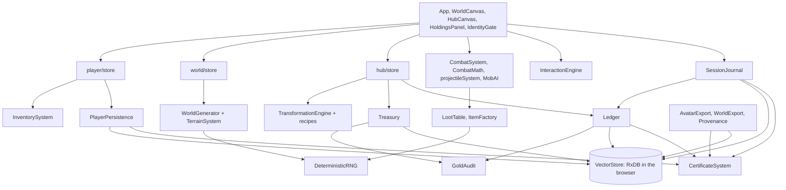

# World Seed: Design Handover

For the next builder, human or agent. It describes the game as it is today, including what does not work. The vision is in `agent.md` and the build order in `PLAN.md`.

**State on 2026-10-30:** the full loop is playable in a browser on one machine. It is not yet multiplayer, has no server, and has never been played by a person from start to finish.

Run it:

```bash
npm install
```
```bash
npm run dev
```
```bash
npm test
```

The game runs on `http://localhost:3000`. The USER/DEV toggle in the header turns on the admin tools and the "grant deed" button in Holdings.

---

## 1. True test results

Lines are from `PLAN.md` section 0. The final run used a fresh profile and real clicks and key events through the game's own handlers. Page scripts only read state, apart from wiping the browser and supplying backup files.

| # | Line | Result | Evidence and limits |
|---|---|---|---|
| 1 | Create identity | Pass | Real form |
| 2 | Reload, identity persists | Pass | Signature verified on load |
| 3 | Enter hub, state restored | Pass | 500G and name shown |
| 4 | Buy a tool | Pass | Real shop; gold moved, item in stash |
| 5 | Deploy, scan, drop | Pass | World created through the real form; landed in the chosen sector |
| 6 | Terrain matters | Pass | Rendered live; blocking and mud covered by tests |
| 7 | Harvest, wrong tool refused | Pass | Axe and bare hands live; refusal covered by tests |
| 8 | Mine, vein depletes | Pass | Pick on rock: uses 2, 1, then gone |
| 9 | Ruin, garrison, chest, lore | Pass | Two guards defeated with an equipped bow |
| 10 | NPC recruited | Pass, with a gap | Real menu to 70, bond received. **The bond was never carried to an exit** |
| 11 | Pack fills, forced choice | Pass | Happened naturally: 37.6/40kg, slowed, overflow cache, items left behind and recovered |
| 12 | Exit point, channel, fee | Pass | Channel completed; interruption by damage seen; fee charged |
| 13 | Haul banked and signed | Pass | Item provenance verified |
| 14 | Reload, all still there | Pass | Ledger chain and gold audit clean |
| 15 | Deed, lot, workshop | **Assisted** | Redeem and build are real; the deed came from the dev button. Natural drops are only covered by a test |
| 16 | Refine at a workshop | Pass, with a change | Sand to glass, not log to planks. Same code path |
| 17 | Another identity buys | Pass, with a limit | Real second identity, **same browser and database** |
| 18 | Penalty from world rules | Pass | Happened repeatedly: carried items lost, receipt sealed as `DIED` |
| 19 | Export, wipe, restore | Pass, with a limit | Byte-identical after a total wipe. **Same browser profile**, and hub state does not travel (see debt) |
| 20 | Same seed, same map | **Partial** | Node and browser produce the same pinned hashes; a stored world matched a fresh generation. **Not run on two separate clients** |

**What this does not prove:**

- It was not one unbroken sitting. It took several sessions, and code was fixed between them.
- There has been no clean re-run on the final code. Automated tests cover the fixes, and the later sessions ran on most of them.
- A script drove the game, so nobody has judged how it feels. A human playtest is the real next step.
- The production build compiles but has never been run.

---

## 2. Systems map



| System | File | Responsibility |
|---|---|---|
| Identity | `entities/identity/certificateSystem.ts` | Keypair, sign, verify |
| Saves | `logic/persistence/PlayerPersistence.ts` | Signed bank doc; verified on load |
| Session record | `logic/journal/SessionJournal.ts` | Signed claim and receipt per session |
| Ledger | `logic/ledger/Ledger.ts` | Append-only signed rows, one chain per identity |
| Gold | `logic/economy/Treasury.ts`, `ExitLevy.ts`, `GoldAudit.ts` | Treasuries, exit fee, ledger replay |
| Backup | `logic/sovereignty/AvatarExport.ts` | Sealed avatar file |
| Item history | `logic/sovereignty/Provenance.ts` | Signed events per banked item |
| World files | `logic/sovereignty/WorldExport.ts` | World certificate transport. No UI yet |
| Generation | `entities/world/WorldGenerator.ts`, `TerrainSystem.ts`, `goldens.ts` | Seed to map; pinned hashes |
| Combat | `entities/combat/*`, `entities/mob/ai/MobAI.ts` | Projectiles, hits, enemy behavior |
| Pack | `entities/player/systems/InventorySystem.ts` | Grid and weight, pure functions |
| Economy | `entities/hub/store.ts`, `entities/economy/*` | Lots, building, crafting, shops, upkeep |

Paths are under `src/`. Note that `WorldCanvas.tsx` still contains the game loop. It should move out of the component.

---

## 3. The contract (`types.ts`)

Treat `types.ts` as the shared agreement, and only add to it. These additions were made during the build:

| Addition | Meaning |
|---|---|
| `ItemType.LORE` | Lore fragments and escort bonds |
| `IGridPlacement`, `inventoryLayout` | Where each item sits in the pack |
| `IEquippedSlots`, `equipped` | Item IDs in use; the items stay in the pack |
| `kitItemIds` | What came in with the player. The exit fee ignores these |
| `carryItemIds` | Stash items chosen for the next session; tools always go |

Do not change `universalDefinitionId` or the meaning of `UniversalRank`. Saved items and generation depend on both.

---

## 4. Data model

Everything lives in one RxDB collection in the browser (`worldseed_db`), separated by namespace. The private key is stored separately in IndexedDB (`WorldSeedIdentity`) and the certificate in `localStorage`.

| Namespace | Document id | Contents |
|---|---|---|
| `characters` | identity uid | Signed bank doc, session removed |
| `transactions` | `ledger_{uid}_{seq}`, `ledger_head_{uid}` | Signed ledger rows and the head pointer |
| `transactions` | `session_{id}` | Signed session receipt |
| `items` | `prov_{itemId}` | Signed provenance chain |
| `worlds` | `inst_{seed}_{size}` | Generated map instance |
| `content` | definition id | Item, enemy, resource and other definitions; world certificates |
| `territories` | `hub_state_{uid}` | Lots and crafting jobs |
| `territories` | `treasury_{uid}`, `endowment_{uid}` | Treasury balance and its one-time starting fund |

**Ledger row types:** `CHARACTER_GENESIS`, `SESSION_RESULT`, `GOLD_DELTA`, `TAX`, `TRADE`, `CRAFT`, `UPKEEP`, `TOMBSTONE`. Rows are never deleted, and appends are queued because each one reads the head first.

**Gold rule:** every movement has a ledger row. `GoldAudit` checks that a player's gold equals their rows, and that treasuries equal the endowments plus all rows on the machine. It can read a brief false mismatch while a multi-step write is running.

---

## 5. Signing model

| What | Signed by | Checked when |
|---|---|---|
| Bank doc | Player key | Every load; failure refuses the save |
| Ledger rows | Player key | `Ledger.audit`, avatar import |
| Session receipt | Player key | Not checked anywhere yet |
| Item provenance | Acting player's key | `Provenance.verify` |
| World certificate | Creator key | **Never verified** |

**What this protects against:** accidental corruption and casual edits to stored data. A changed save or backup file is refused.

**What it does not protect against:** the player. The private key is extractable and sits in the same browser, so anyone willing to open the console can re-sign anything they like. Nothing here is anti-cheat. Stopping that needs a server that replays session records from the seed, which the journal and keyed rolls were designed to allow but which does not exist.

A provenance record carries its signer's public key. That proves the chain is intact, not whose key it is. Linking keys to identities needs a registry.

---

## 6. Determinism charter

- Every gameplay roll comes from `Rng.fromKey(key)`. The same key always gives the same result.
- Key formats: loot `{seed}:{sessionId}:loot:{mobId}`, harvest `{seed}:{sessionId}:harvest:{nodeId}:{use}`, shop `{hubId}:shop:{day}:{type}:{rank}:{slot}`, terrain `{seed}:elev:v1:{x},{y}`.
- `Math.random` in gameplay is a bug. Known remaining case: `SpellEngine.ts:23`. `WorldCertificate.ts:303` is allowed because it creates a new world's identity. The unkeyed fallbacks in `ItemFactory` and `LootTable` log a warning.
- Definitions are sorted by id before generation, so database order cannot change a world.
- `tests/world.test.ts` and the boot check pin three reference hashes. If you change generation on purpose, recapture them with `window.__captureGoldens()` in dev and paste the output into `goldens.ts`. Bump the layer version (for example `elev:v1`) when old worlds must keep their shape.
- Stored world instances are not regenerated, so a generation change does not reach a world that is already stored.

---

## 7. Tuning table

These are the current values, set by reasoning and very little play. Expect to change them.

| Value | Current | Where |
|---|---|---|
| Player speed | 3 tiles/s (60px/s) | `WorldCanvas.tsx` |
| Enemy speed | 2 tiles/s | `MobAI.ts` |
| Enemy alert / give-up range | 8 / 16 tiles | `MobAI.ts` |
| Enemy attack interval | 2s | `MobAI.ts` |
| Projectile speed / flight | 200px/s for 2s | `projectileSystem.ts` |
| Hit radius, enemy / player | 20px / 15px | `CombatSystems.ts`, `WorldCanvas.tsx` |
| Weapon damage | 6 + item power × 0.08 | `CombatMath.ts` |
| Unarmed damage / rate | 5 / 1 per second | `CombatMath.ts` |
| Mitigation cap | 60% | `CombatMath.ts` |
| Starting health | 100 + constitution × 10 | `player/store.ts` |
| Pack | 8 × 6 cells | `InventorySystem.ts` |
| Carry limit | 30 + strength × 10 kg | `InventorySystem.ts` |
| Over-load slowdown | Above 80%: 0.5× speed | `InventorySystem.ts` |
| Channel / exit range | 5s / 60px | `WorldCanvas.tsx` |
| Exit fee | World rule, default 5% of what was gained | `ExitLevy.ts` |
| Chunk spawns | Enemies 40% (1–2), resources 50% (1–4), ruins 8%, NPCs 5% | `WorldGenerator.ts` |
| NPC secure threshold | 70 disposition | `InteractionEngine.ts` |
| Starting gold | 500 | `player/store.ts` |
| Shop markup / vendor buyback | 1.5× / 0.6× of value | `hub/store.ts` |
| Player shop fee | 5% | `recipeDefinitions.ts` |
| Lot price | 5,000G | `hub/store.ts` |
| Build cost | House 100, Workshop 150, Vendor 250 | `recipeDefinitions.ts` |
| Upkeep per day | Empty 5, House 5, Workshop 10, Vendor 15 | `recipeDefinitions.ts`, `hub/store.ts` |
| Hub starting fund | 100,000G | `hub/store.ts` |
| Autosave delay | 10s, plus immediately on hub actions | `PlayerPersistence.ts` |

**Open balance questions, for playtest:** gear sold for far more than tools cost (one pair of gauntlets paid 600G against a 36G axe). Deeds are extremely rare. Enemy density around exit points is high, about 7–8 within 300px.

---

## 8. Debt register

Each entry says when it will cause trouble.

**Architecture**

| Debt | Breaks when |
|---|---|
| No server; all state is in one browser | Two real players need to share anything |
| Client holds the key and decides all outcomes | Anything of value depends on honesty |
| Hub, lots and treasury are per-machine | A restored avatar on a new machine gets a new hub, and its treasury audit reports drift |
| Game loop lives in `WorldCanvas.tsx` | You want logic tests without a browser, or a replay notary |
| Any exception stops the loop silently | Any new bug freezes the game with no message. A freeze like this already happened once |
| Multi-document writes are not atomic | The tab closes between the gold change and its ledger row |

**Gameplay gaps**

| Debt | Breaks when |
|---|---|
| World changes reset on each deploy (depletion, defeated enemies, caches) | A player returns for a stashed cache, which plan W3.3 promised |
| Reloading mid-session loses the kit, which has already left the bank | Any refresh or crash during a run. Decide if that is intended |
| Escort bonds cannot be redeemed for anything, and give no reputation | A player tries to use one |
| `XP_LOSS` and `PERMADEATH` behave like `INVENTORY_LOSS` | A world picks them |
| Entry fee, creator share, world stats and session limits are not enforced | A world creator expects them |
| World countdown resets on list refresh; worlds do not expire by it | Scarcity matters |
| The hub appears as a deployable zone | Always; it is confusing |
| Harvest and interaction times are ignored; energy never regenerates | Long sessions run out of energy |
| Auto-pickup has no prompt, and walking over drops can overload you | Noticeably annoying already. Plan W3.2 wanted a prompt |
| Pack has auto-place and rotate but no drag | Plan W3.1 wanted drag |
| Rendering is 26 FPS with all entities in the DOM; off-screen ones are not culled | Larger worlds |
| Shop stock resets on every reload | Stock limits matter |
| Rejected saves leave a blank "Unknown" character and no explanation | A save is really damaged |

**Content and AI**

| Debt | Breaks when |
|---|---|
| Enemy AI genre is hardcoded to sci-fi, so rats shoot; enemies ignore terrain | Enemy variety matters |
| One genre has no enemy definitions, so those chunks and their ruins are unguarded | Ruins are expected to be dangerous |
| Overlapping entities are hard to click | Dense areas |
| Vendor dialogue options do nothing: sell, repair, guilds, auction, rest, hints and more | A player clicks them. Selling works from Holdings |
| `SpellEngine` is a sketch; magic foci only fire a burst pattern | Spells are expected |

---

## 9. Decisions waiting on you

1. **Gold source.** Total gold was fixed, so a 5,000G lot could never be bought. I added a one-time 100,000G hub fund that pays for sold goods. It keeps gold conserved and is easy to change. The alternative is direct gold drops from enemies, which LootTable originally planned.
2. **Mid-session reload.** Treat it as a loss (current), or save sessions so they resume?
3. **Persistent worlds.** Should changes survive between sessions within a world's lifetime? Plan W3.3 implies yes.
4. **Starting kit.** New characters get one random item and must buy a weapon. Should they start with one?

---

## 10. Next worlds

Noted here so the seams stay visible. None of it has been started.

- **Server notary:** replay a session from its seed and journal; this is what would make the signatures mean something against cheating.
- **Real multiplayer:** shared hubs, then shared sessions.
- **Certificate registry:** real identity for world creators and item history.
- **Auction house:** types exist; no system.
- **3D renderer:** the React Three Fiber dependencies are installed but unused.
- **Browser end-to-end tests:** turn the true test into a Playwright script so it can run unattended.

---

## 11. Lessons from the build

These are the mistakes that cost the most, for whoever works on this next.

- **Check that a player can reach it.** Several waves were marked done after calling functions from scripts, while four test lines had no UI at all.
- **Test with the real data path.** Dev-mode database objects are frozen, and hand-built test objects are not. That hid a crash that froze the game.
- **A passing test can check the wrong thing.** Pinned hashes confirmed a world with 68 boss enemies was consistent. They said nothing about whether it was sane.
- **Measure before diagnosing.** "Spawn density is too high" was really one projectile hitting 11 times. "The game is too hard" and "FPS is too low" were both wrong too, and a session receipt and a two-second measurement settled them.
